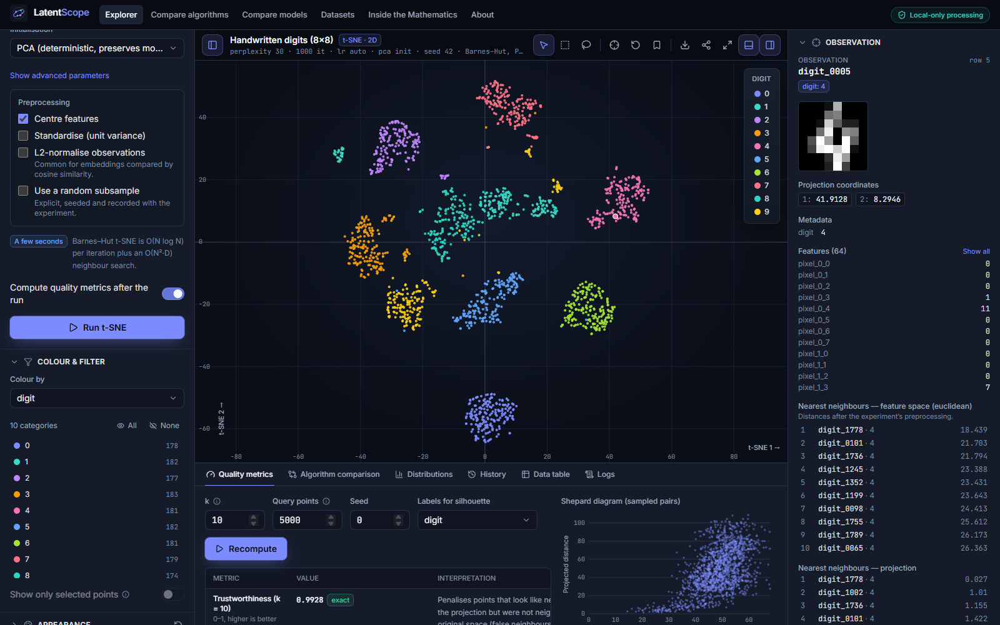
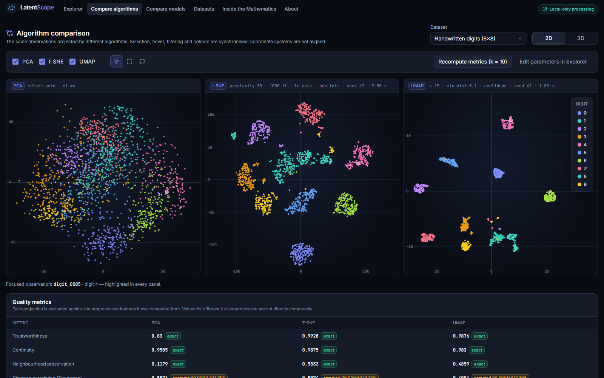
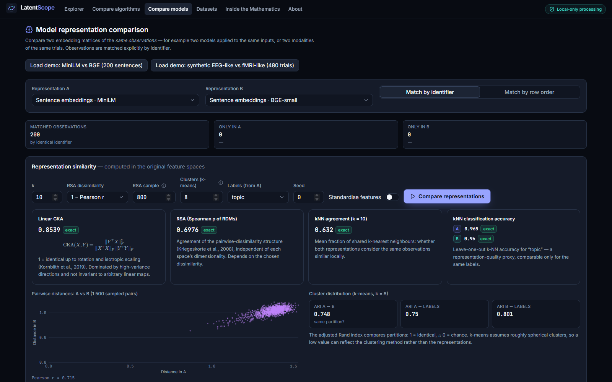
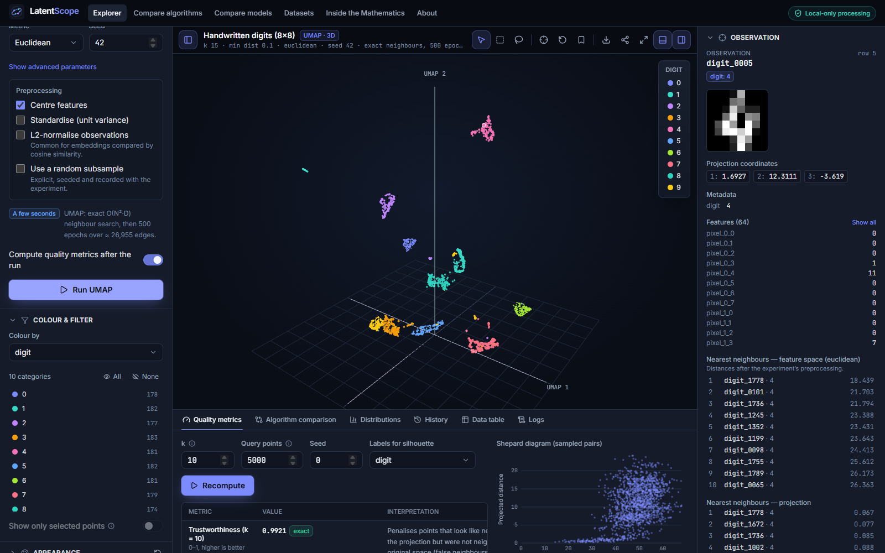
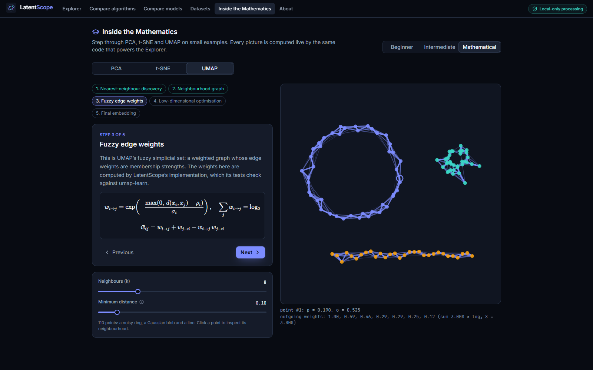

# LatentScope

**Explore the Geometry of Intelligence** — an interactive scientific workspace for understanding,
visualizing and comparing high-dimensional machine-learning representations. Everything runs in
your browser: no server, no uploads, no analytics.



> **Live demo:** `https://<username>.github.io/latentscope/` — available once the repository is
> pushed and the Pages workflow has run (see [Deployment](#deployment)). Replace `<username>` with
> the GitHub account that hosts the repository.

## What it does

|                        |                                                                                                                                                                                                                                                                                                |
| ---------------------- | ---------------------------------------------------------------------------------------------------------------------------------------------------------------------------------------------------------------------------------------------------------------------------------------------- |
| **Import embeddings**  | CSV, TSV, JSON, NPY and NPZ through a six-step wizard. Every cell is validated; missing, non-numeric or infinite values are reported with locations and resolved only by an explicit choice (reject / drop rows / impute mean). Duplicate IDs are rejected. Memory is estimated before import. |
| **Project**            | PCA (SVD / covariance / Gram eigendecomposition, randomized SVD on request), t-SNE (exact and Barnes–Hut, 2D/3D, live previews) and UMAP (umap-js, exact neighbours for N ≤ 4 000). All in Web Workers, seeded and cancellable, with honest progress.                                          |
| **Visualize**          | GPU point clouds (Three.js / React Three Fiber) in 2D and 3D: pan, zoom, rotate, fit, reset, camera bookmarks, hover, click-to-inspect, rectangle and lasso selection, legends that filter, colour by any label/metadata/cluster, colour-blind-safe palettes and shape encoding.               |
| **Inspect**            | Observation details, 8×8 image or URL previews, text, features, nearest neighbours in feature space _and_ projection, selection composition and distinctive features, category and dataset statistics, and an accessible keyboard-navigable data table.                                        |
| **Measure**            | Trustworthiness, continuity, neighbourhood preservation, distance correlation (Shepard diagram) and silhouette in original vs. projected space — each with its sample size, seed and exact/approximate status.                                                                                 |
| **Compare algorithms** | PCA, t-SNE and UMAP side by side with synchronised selection, hover and filters, plus a metrics table.                                                                                                                                                                                         |
| **Compare models**     | Two embedding matrices of the same observations, matched explicitly by identifier: linear CKA, RSA, kNN agreement, kNN accuracy, k-means agreement (ARI), distance scatter, and Procrustes-aligned side-by-side projections.                                                                   |
| **Cluster**            | k-means, DBSCAN and agglomerative (Ward/average/complete/single), in feature or projection space, stored separately from ground-truth labels.                                                                                                                                                  |
| **Learn**              | _Inside the Mathematics_: step-by-step PCA, t-SNE and UMAP tutorials at three levels (beginner / intermediate / mathematical) with KaTeX, all computed live by the production code.                                                                                                            |
| **Reproduce & export** | Every run records dataset SHA-256, algorithm version, parameters, seed, preprocessing, metrics and runtime (IndexedDB history). Export vector SVG / high-resolution PNG (metadata embedded), CSV/JSON coordinates, session files and configuration-only share links.                           |

<table>
<tr>
<td></td>
<td></td>
</tr>
<tr>
<td></td>
<td></td>
</tr>
</table>

## Scientific methodology

Correctness is tested against reference implementations, not asserted:

- **PCA** loadings, variances and scores match scikit-learn to 1e-8 through every solver path;
  orthogonality, reconstruction and rank deficiency are tested.
- **t-SNE** affinities, KL divergence and gradient match scikit-learn's internals to float32
  precision; on Digits, neighbourhood quality matches scikit-learn's TSNE (trustworthiness 0.9928
  vs. 0.9926).
- **UMAP** fuzzy-graph weights (tutorial implementation) match umap-learn to 1e-4; umap-js
  projections match umap-learn's neighbourhood quality on Digits (0.9876 vs. 0.9876–0.9887).
  umap-js uses random rather than spectral initialisation, so coordinates are not claimed to match
  Python.
- **Metrics** (trustworthiness, continuity, silhouette, CKA, RSA, Procrustes, ARI) and
  **clustering** (k-means, DBSCAN, linkage heights) match scikit-learn / SciPy.

Details, formulas and caveats: [docs/algorithms.md](docs/algorithms.md) ·
reproducibility: [docs/reproducibility.md](docs/reproducibility.md).

## Demonstration datasets

Synthetic Gaussian clusters (configurable) · Swiss roll · Iris (UCI, CC BY 4.0) · Handwritten
digits (UCI, CC BY 4.0) · sentence embeddings from two pretrained transformers
(all-MiniLM-L6-v2 and bge-small-en-v1.5 on a CC0 corpus written for this project) · a clearly
labelled **synthetic** EEG-like/fMRI-like paired-modality set. Sources, licences, preprocessing and
citations: [docs/datasets.md](docs/datasets.md).

## Supported input formats

| Format          | Layout                                                                                                                                                                                              |
| --------------- | --------------------------------------------------------------------------------------------------------------------------------------------------------------------------------------------------- |
| CSV / TSV / TXT | One row per observation; choose feature, ID, label and metadata columns. Header auto-detected.                                                                                                      |
| JSON            | Array of row objects (array fields such as `"embedding": [...]` are expanded), `{ "embeddings": [[...]], "ids": [...], "labels": [...] }`, an array of arrays, or LatentScope's own dataset format. |
| NPY             | 2-D numeric array (float16/32/64, signed/unsigned ints, bool; either byte order; C or Fortran order). N-D arrays can be flattened explicitly. Pickled object arrays are refused.                    |
| NPZ             | Choose the embedding array; 1-D arrays of the same length can supply IDs and labels. Stored or deflated archives.                                                                                   |

## Technology

React 19 · TypeScript (strict) · Vite 7 · Tailwind CSS 4 · Radix UI · Lucide · Zustand ·
Three.js + React Three Fiber + Drei · umap-js · ml-matrix · PapaParse · fflate · Dexie
(IndexedDB) · KaTeX · Web Workers · Vitest + Testing Library · Playwright · ESLint · Prettier ·
GitHub Actions + GitHub Pages. Architecture: [docs/architecture.md](docs/architecture.md).

## Getting started

```bash
npm ci
npm run dev            # http://localhost:5173
```

| Command                                                                   | Purpose                                                                                     |
| ------------------------------------------------------------------------- | ------------------------------------------------------------------------------------------- |
| `npm run dev`                                                             | Development server with hot reload                                                          |
| `npm run build`                                                           | Type-check and build to `dist/` (base path `/latentscope/`, override with `BASE_PATH`)      |
| `npm run preview`                                                         | Serve the production build at `http://localhost:4173/latentscope/`                          |
| `npm test`                                                                | Unit, integration and scientific tests (Vitest)                                             |
| `npm run test:e2e`                                                        | End-to-end tests against the production build (run `npx playwright install chromium` once)  |
| `npm run lint` / `npm run typecheck` / `npm run format:check`             | Code quality gates                                                                          |
| `npx vitest run --config vitest.perf.config.ts --disableConsoleIntercept` | Opt-in timing probe at 10 000 points                                                        |
| `npm run references:build`                                                | Regenerate scientific fixtures (Python with NumPy, SciPy, scikit-learn, umap-learn)         |
| `python scripts/build_datasets.py`                                        | Rebuild the Iris and Digits files                                                           |
| `npm run embeddings:build`                                                | Recompute the sentence embeddings (after `npm install --no-save @huggingface/transformers`) |

## Deployment

The repository includes `.github/workflows/deploy.yml`, which lints, type-checks, tests, builds
with the correct base path and deploys with the official Pages actions.

1. Push to a GitHub repository named `latentscope` (any name works; the base path is detected).
2. **Settings → Pages → Source: GitHub Actions.**
3. Push to `main`. The site appears at `https://<username>.github.io/latentscope/`.

Hash-based routing means deep links and refreshes work without any 404 fallback. Full details,
manual deployment and portfolio-integration notes: [docs/deployment.md](docs/deployment.md).

## Privacy

Files are parsed and analysed on your device. LatentScope has no backend and no analytics; saved
datasets live in your browser's IndexedDB and can be deleted from the Datasets page. Share links
carry configuration only. Image URLs in your metadata are fetched only when you click to load them.

## Known limitations

- Computation is bounded by browser memory and a single worker thread per job. Exact neighbour
  search is O(N²·D); for very large datasets use the explicit, seeded subsampling option.
  Measured on the development machine for 10 000 × 50 points (`tests/perf`, single thread):
  PCA 0.2 s, UMAP 7 s, Barnes–Hut t-SNE 52 s (1 000 iterations), quality metrics ≈ 4 s. Times
  scale with hardware; the app shows a cost estimate before each run.
- Rendering uses one GPU draw call per layer and redraws only on change, but frame rates have not
  been benchmarked across devices; very large point counts depend on the GPU.
- Exact t-SNE is capped at 5 000 points and hierarchical clustering at 3 000.
- umap-js lacks spectral initialisation and densMAP; results differ from umap-learn by design.
- 3D figures export as raster PNG (no faithful vector form exists for a perspective rendering).
- The interface is dark-themed only.
- WebGL is required for the point-cloud views (the data table and inspector work without it).

## Roadmap

Multi-threaded neighbour search (WebAssembly + SIMD), approximate nearest neighbours for metrics
on very large datasets, aligned UMAP / parametric projections, a light theme, and more
representation-similarity measures (e.g. SVCCA, debiased CKA).

## Contributing

See [docs/contributing.md](docs/contributing.md). Scientific changes require reference fixtures and
tests; nothing may be presented as computed unless it is.

## License

[MIT](LICENSE). Bundled datasets carry their own licences ([docs/datasets.md](docs/datasets.md)).
